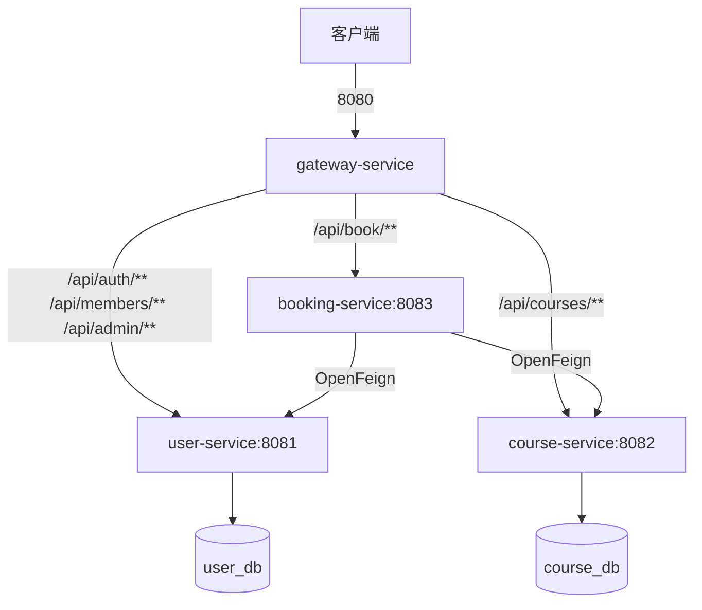

# 健身房会员管理系统

课程：微服务开发与实践<br>
姓名：程子恒<br>
学号：2412190718<br>
仓库用途：作业提交

## 项目简介

本项目是一个基于微服务架构的健身房会员管理系统，为传统健身房提供数字化运营方案，打通会员、教练和管理员之间的信息壁垒。

业务背景：传统健身房在会员管理、排课预约、签到消课等环节依赖人工记录，容易出现信息差错、体验不佳等问题。本项目通过微服务拆分解决这一痛点。

目标用户：

- 管理员：管理健身房日常运营、会员卡种、教练排班和财务数据。
- 教练：查看排班表、查看预约名单、核销会员签到。
- 会员：注册登录、购买会员卡或课包、在线预约、查看历史记录。

## 用户角色与权限

| 角色 | 权限 |
| :--- | :--- |
| 游客 | 只能访问登录接口和健康检查接口 |
| MEMBER | 登录、查看会员信息、预约课程、查看课程 |
| ADMIN | 会员的全部权限，并可访问 /api/admin/** 管理接口 |

演示账号：

| 用户名 | 密码 | 角色 |
| :--- | :--- | :--- |
| admin | root | ADMIN |
| member | root | MEMBER |

密码使用 BCrypt 哈希保存，数据库中只保存哈希。

## 技术栈

- Java 25
- Spring Boot 4.1.x
- Spring Cloud 2025.1.x
- Spring Cloud Alibaba 2025.1.x
- Spring Cloud Gateway Server WebFlux
- Spring Security + JWT HS256
- Spring Data JPA + MySQL 8.4
- Nacos 3.2
- OpenFeign + LoadBalancer
- Docker Compose

## 仓库结构

```text
.
├── compose.yaml
├── .env.example
├── init.sql
├── README.md
├── docs/
│   ├── project-proposal.md
│   ├── database.md
│   ├── microservices-design.md
│   ├── service-communication.md
│   ├── security.md
│   └── homework/week-01 ... week-09
├── scripts/
│   ├── smoke-test.sh
│   ├── e2e-test.sh
│   └── auth-test.sh
├── monolith/
└── services/
    ├── gateway-service/
    ├── user-service/
    ├── course-service/
    └── booking-service/
```

## 架构



外部请求统一从网关进入。网关校验 JWT 后按路径转发，下游服务不信任客户端传来的身份请求头。

## 网关路由

| 路径 | 目标服务 | 认证要求 |
| :--- | :--- | :--- |
| /api/auth/login | user-service | 公开 |
| /api/auth/me | user-service | 需要 JWT |
| /api/members/** | user-service | 需要 JWT |
| /api/admin/** | user-service | 需要 ADMIN |
| /api/courses/** | course-service | 需要 JWT |
| /api/book/** | booking-service | 需要 JWT |
| /api/health | gateway-service | 公开 |

## 快速开始

环境要求：JDK 25、Maven 3.9+、Docker Desktop。

复制环境变量模板：

```bash
cp .env.example .env
```

确认 .env 中的 NACOS_PASSWORD 和 JWT_SECRET。JWT_SECRET 至少 32 字节，user-service 与 gateway-service 必须一致。

首次启动 Nacos 3.x 需要初始化管理员密码：

1. 打开 http://localhost:18080/
2. 设置 nacos 用户密码
3. 将密码写入 .env 的 NACOS_PASSWORD

构建并启动：

```bash
docker compose up -d --build
docker compose ps
```

健康检查：

- 网关：http://localhost:8080/api/health
- Actuator：http://localhost:8080/actuator/health
- Nacos：http://localhost:18080/

## 登录与接口示例

登录：

```bash
curl -s -X POST http://localhost:8080/api/auth/login \
  -H 'Content-Type: application/json' \
  -d '{"username":"admin","password":"root"}'
```

响应：

```json
{
  "accessToken": "eyJhbGciOiJIUzI1NiJ9....",
  "tokenType": "Bearer",
  "expiresIn": 7200,
  "username": "admin",
  "role": "ADMIN"
}
```

访问管理接口：

```bash
curl -i -H "Authorization: Bearer <accessToken>" \
  http://localhost:8080/api/admin/members
```

预约课程：

```bash
curl -X POST "http://localhost:8080/api/book?memberId=1&courseId=1" \
  -H "Authorization: Bearer <accessToken>"
```

## 测试

各服务测试不依赖真实 Nacos 和 MySQL：

```bash
cd services/user-service
./mvnw -s settings.xml test

cd ../gateway-service
./mvnw -s settings.xml test

cd ../course-service
./mvnw -s settings.xml test

cd ../booking-service
./mvnw -s settings.xml test
```

认证与网关验收：

```bash
bash scripts/auth-test.sh
```

冒烟检查：

```bash
bash scripts/smoke-test.sh
```

跨服务预约与负载均衡：

```bash
docker compose up -d --build --scale course-service=2
bash scripts/e2e-test.sh
```

## 每周文档

- week-01 需求与选题
- week-02 Spring Boot 起步
- week-03 单体应用与数据库持久化
- week-04 业务规则与测试
- week-05 Docker 容器化
- week-06 微服务拆分
- week-07 服务注册与发现
- week-08 服务通信与负载均衡
- week-09 API Gateway、JWT 认证与网关鉴权

## 安全说明

- 密码使用 BCrypt 哈希存储，不保存明文。
- JWT 使用 HS256，密钥通过环境变量注入。
- 网关删除客户端伪造的 X-User-* 请求头，只写入验签后的身份信息。
- 管理接口在网关和 user-service 两层校验 ADMIN 角色。
- 生产部署只应暴露 gateway-service 的 8080 端口，8081、8082、8083 仅用于本地调试。
