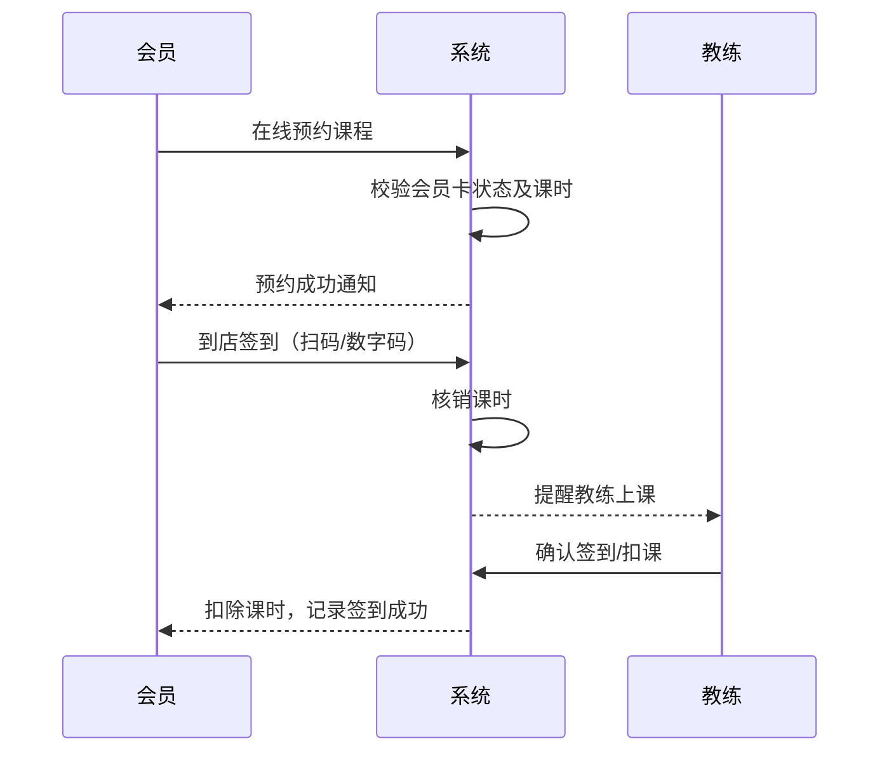

课程：微服务开发与实践 
姓名：程子恒
学号：2412190718
仓库用途：作业提交
# 健身房会员管理系统 (Gym Membership Management System)

## 项目简介
本项目是一个基于微服务架构的健身房会员管理系统，旨在为传统健身房提供数字化运营方案，打通会员、教练和管理员之间的信息壁垒。

## 业务背景与目标用户
**业务背景：** 传统健身房在会员管理、排课预约、签消课等环节依赖人工记录，容易出现信息差错、体验不佳等问题。本项目旨在通过软件开发解决这一痛点。
**目标用户：**
- **管理员**：管理健身房日常运营、会员卡种、教练排班和财务数据。
- **教练**：查看排班、管理个人课程、确认学员签到情况。
- **会员**：在线查看课程、预约课程、购买会员卡、查看签到记录。

## 用户角色及需求
| 角色 | 核心需求 |
| :--- | :--- |
| 管理员 | 会员及卡种管理、教练排班、营收报表、系统设置 |
| 教练 | 查看排课表、查看预约名单、核销会员签到 |
| 会员 | 注册登录、购买会员卡/课包、在线预约、查看历史记录 |

## 功能模块划分
| 模块名称 | 包含功能 |
| :--- | :--- |
| **会员管理** | 会员注册、信息修改、会员卡办理、续费、卡种管理 |
| **课程与教练** | 教练管理、课程录入、排课计划、课程取消与修改 |
| **预约管理** | 查看可预约课程、在线预约、取消预约、预约名单 |
| **签到与核销** | 到店扫码/输入码签到、教练确认、课时扣减 |
| **支付与订单** | 购买课包/会员卡、订单生成、支付状态同步、退款处理 |

## 运行与测试说明

### 环境要求
- Java 25
- Maven 3.9+

### 启动与测试命令
在 `monolith/` 目录下执行：
- 运行测试：`./mvnw test`
- 启动应用：`./mvnw spring-boot:run`

### 接口与健康检查
- 问候接口：`GET http://localhost:8080/api/hello`
- 健康检查：`GET http://localhost:8080/actuator/health`

### 当前尚未实现的业务能力
本周仅完成 Spring Boot 基础设施搭建，尚未实现数据库持久化、会员卡务、课程预约、签到等具体业务逻辑，后续将逐步完善。


## 核心业务流程 (Mermaid 图)


## 数据库配置与启动说明（作业04新增）

### 1. 本地 MySQL 安装与配置
- 需在本机安装 MySQL 8.0+。
- 创建数据库：`CREATE DATABASE gymdb;`
- 创建用户并授权：`CREATE USER 'gymuser'@'localhost' IDENTIFIED BY 'GymPass123!'; GRANT ALL ON gymdb.* TO 'gymuser'@'localhost';`
- 在 `src/main/resources/application.yml` 中已配置好对应的连接信息。

### 2. 启动与测试命令
- 启动应用：`./mvnw spring-boot:run`
- 运行自动化测试（使用 H2 内存库）：`./mvnw test`

### 3. Curl 接口测试示例
**示例 1：创建会员**
```bash
curl -X POST "http://localhost:8080/api/member" -H "Content-Type: application/json" -d '{"name":"程子恒","phone":"123456","remainingSessions":3}'
```
**示例 2：预约课程（核心业务）**
```bash
curl -X POST "http://localhost:8080/api/book" -H "Content-Type: application/json" -d '{"memberId":1,"courseId":1}'
```

## Docker Compose 启动说明

1. 复制环境变量模板：`cp .env.example .env`
2. 一键构建并启动服务：`docker compose up -d --build`
3. 查看服务状态：`docker compose ps`
4. 停止服务（保留数据）：`docker compose down`

**健康检查接口**：`GET http://localhost:8080/actuator/health`
**创建会员接口**：`POST http://localhost:8080/api/member`