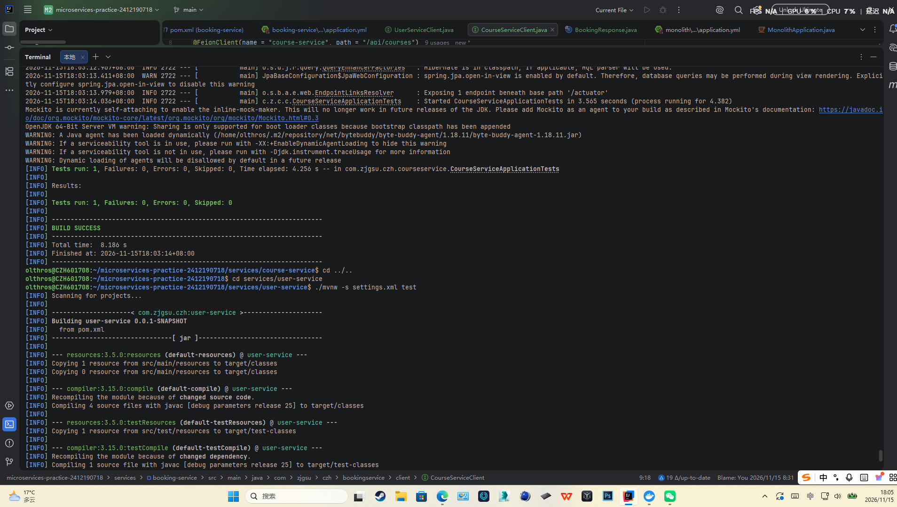
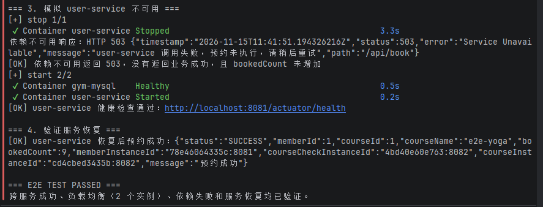
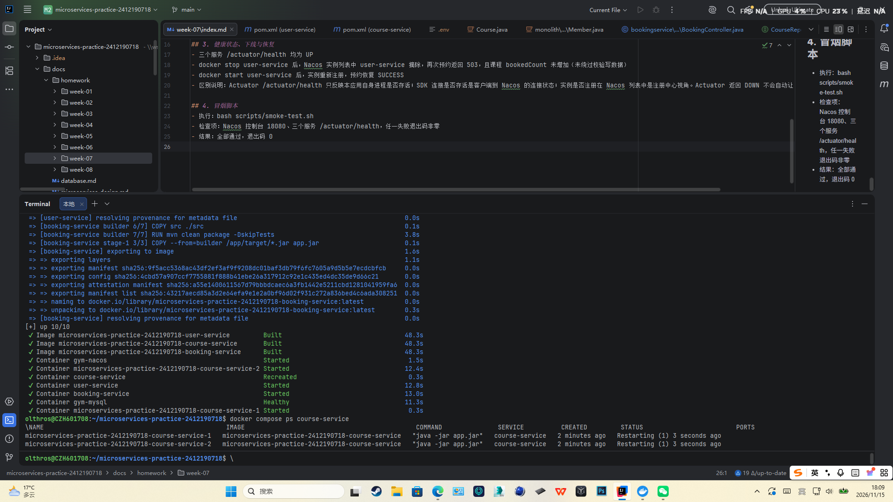
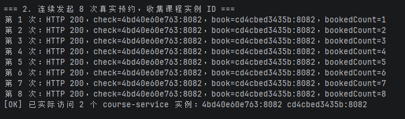
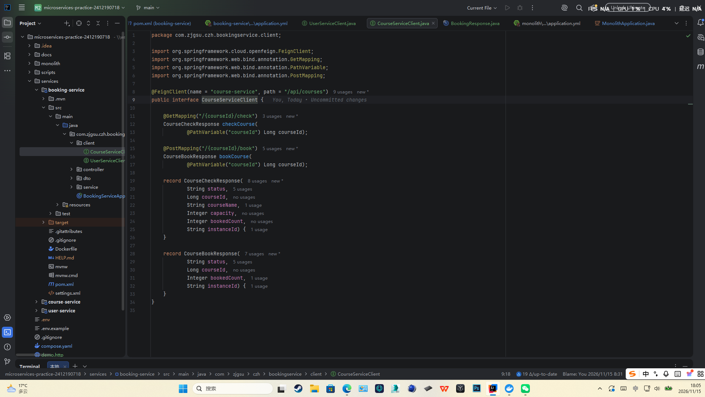

# week-08 服务通信与负载均衡

> 本文数据来自 2026-11-15 本地 Docker Compose 实际运行结果。

## 1. 选择一个跨服务业务流程

### 实现思路

本次选择“会员预约健身课程”作为跨服务业务流程。

booking-service 是调用方，user-service 和 course-service 是被调用方。

booking-service 接收到预约请求后，首先调用 user-service 查询会员是否存在以及是否有剩余课时，然后调用 course-service 查询课程是否存在以及是否还有剩余名额，最后调用 course-service 完成预约写入。

booking-service 不直接访问其他服务的数据库，也不进行跨数据库 JOIN。

详细的调用链路和接口边界见 [docs/service-communication.md](../../service-communication.md)。

### 运行命令

```bash
docker compose up -d --build --scale course-service=2
docker compose ps
bash scripts/e2e-test.sh
```

### 运行结果

- 实际会员 ID：1
- 实际课程 ID：1
- 预约返回的 status：SUCCESS
- 关键结论：8 次预约中 bookedCount 从 1 递增到 8，说明只有会员和课程校验都通过后才增加；user-service 停止后返回 503，bookedCount 保持 8 不变，没有写入课程名额。

## 2. 使用 OpenFeign

### 实现思路

booking-service 增加了以下依赖：

- `spring-cloud-starter-openfeign`
- `spring-cloud-starter-loadbalancer`

在启动类上添加 `@EnableFeignClients` 开启 OpenFeign。

`UserServiceClient` 和 `CourseServiceClient` 分别通过以下注解按服务名调用：

- `@FeignClient(name = "user-service", path = "/api/members")`
- `@FeignClient(name = "course-service", path = "/api/courses")`

代码中没有写死容器 IP。

BookingService 对不同失败情况进行了区分：

- 会员不存在：HTTP 404
- 会员剩余课时不足：HTTP 400
- 课程不存在：HTTP 404
- 课程满员：HTTP 409
- 依赖服务调用失败：HTTP 503
- 课程写请求超时：HTTP 504，并包含 `WRITE_RESULT_UNKNOWN`

有响应体的业务接口均返回可检查的 JSON。

### 运行命令

```bash
cd services/booking-service
./mvnw -s settings.xml test
cd ../..
bash scripts/e2e-test.sh
```

### 运行结果

- OpenFeign 成功响应中的 memberInstanceId：78e46064335c:8081
- OpenFeign 成功响应中的 courseCheckInstanceId：4bd40e60e763:8082
- OpenFeign 成功响应中的 courseInstanceId：cd4cbed3435b:8082
- 依赖不可用时的 HTTP 状态码和错误信息：503，`user-service 调用失败，预约未执行，请稍后重试`

本次预约成功响应原文：

```json
{
  "status": "SUCCESS",
  "memberId": 1,
  "courseId": 1,
  "courseName": "e2e-yoga",
  "bookedCount": 9,
  "memberInstanceId": "78e46064335c:8081",
  "courseCheckInstanceId": "4bd40e60e763:8082",
  "courseInstanceId": "cd4cbed3435b:8082",
  "message": "预约成功"
}
```

依赖不可用响应原文：

```json
{
  "timestamp": "2026-11-15T11:41:51.194326216Z",
  "status": 503,
  "error": "Service Unavailable",
  "message": "user-service 调用失败，预约未执行，请稍后重试",
  "path": "/api/book"
}
```

### 验证截图





## 3. 负载均衡验证

### 实现思路

course-service 启动两个实例。

compose.yaml 删除了 course-service 的 `container_name`，并使用 `127.0.0.1::8082` 让 Docker 分配不同的随机宿主机端口，避免多实例端口冲突。

两个实例仍在容器网络内监听 8082，并注册到同一个 Nacos 服务名和 `PERSONAL_GROUP` 分组。

每次成功预约都会返回：

- `courseCheckInstanceId`：实际处理课程查询的实例
- `courseInstanceId`：实际处理课程写入的实例

端到端脚本连续预约 8 次并同时收集这两个字段。只有实际观察到至少两个不同实例 ID，才判定负载均衡验证通过，而不是只展示 Nacos 注册列表。

### 运行命令

```bash
docker compose up -d --build --scale course-service=2
docker compose ps course-service
bash scripts/e2e-test.sh
```

### 运行结果

- course-service 实例 1：容器名 `microservices-practice-2412190718-course-service-1`，宿主机端口 61469
- course-service 实例 2：容器名 `microservices-practice-2412190718-course-service-2`，宿主机端口 61470
- 8 次预约中实际出现的 instanceId：`4bd40e60e763:8082`（负责课程查询）和 `cd4cbed3435b:8082`（负责课程写入）
- 8 次请求实际观察到的不同实例数：2

### 验证截图





## 4. 测试

### 实现思路

`BookingServiceTest` 使用 Mockito 模拟两个 FeignClient，覆盖以下五种情况：

1. 会员和课程校验通过，预约成功并返回实例 ID。
2. 会员课时不足，返回 400，不调用课程服务。
3. 课程满员，返回 409，不执行课程写入。
4. user-service 不可用，返回 503，不调用课程服务。
5. 课程写请求超时，返回 504 和 `WRITE_RESULT_UNKNOWN`。

`scripts/e2e-test.sh` 可以从仓库根目录运行，自动创建全新的测试数据，完成真实跨服务预约和负载均衡检查。

随后脚本会停止 user-service，验证：

1. 预约请求返回 HTTP 503。
2. 响应不会被误判为业务成功。
3. 课程 bookedCount 不会增加。

最后脚本恢复 user-service，并再次验证预约成功。

脚本每次都会创建新的测试数据，因此可以重复执行。

### 运行命令

```bash
cd services/booking-service
./mvnw -s settings.xml test
cd ../..
bash scripts/e2e-test.sh
```

### 运行结果

- Maven 测试总数、失败数、错误数：6、0、0
- E2E 最后一行：`=== E2E TEST PASSED ===`
- 依赖失败前后的 bookedCount：8 和 8

### 写操作超时说明

写操作超时只代表没有及时收到响应，课程名额可能已经被修改，因此结果未知。

调用方必须先查询课程状态，不能直接把超时当作可安全重试的失败，也不能直接将其视为业务成功。

### 验证截图




