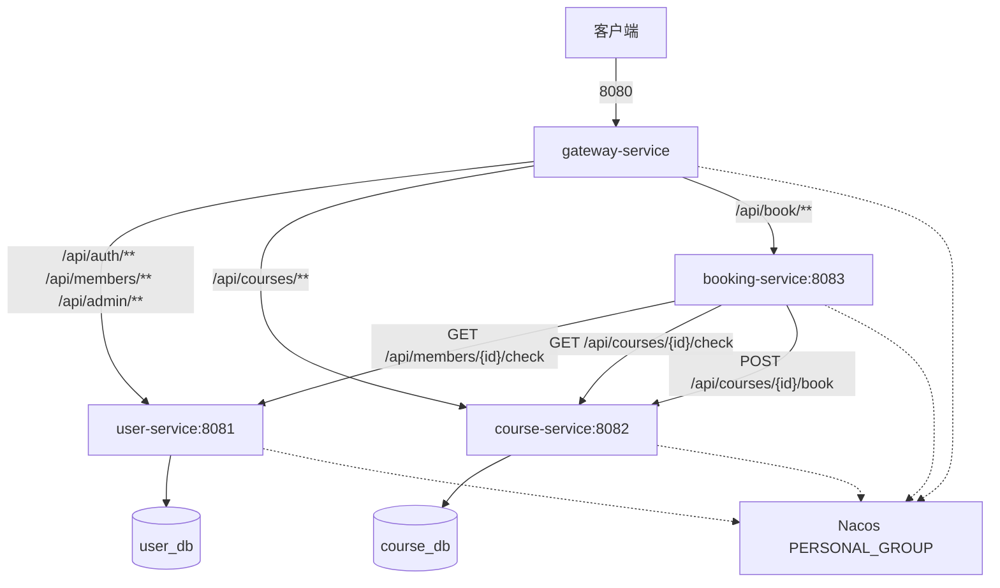

# 微服务拆分设计

## 拆分映射

- 单体 monolith 中的 Member 模块拆分为 user-service。
- 单体中的 Course 模块拆分为 course-service。
- 单体中的 BookingService 跨服务业务逻辑拆分为 booking-service。
- week-09 新增 gateway-service，作为所有外部请求的统一入口。

## 微服务职责与端口

| 服务名 | 端口 | 独立数据库 | 拥有的数据 | 职责说明 |
| :--- | :--- | :--- | :--- | :--- |
| gateway-service | 8080 | 无 | 无 | 统一入口、JWT 校验、路由转发、身份头清洗 |
| user-service | 8081 | user_db | members、user_accounts | 会员信息、课时余额、登录账号、JWT 签发 |
| course-service | 8082 | course_db | courses | 课程信息、容量、已预约人数 |
| booking-service | 8083 | booking_db | bookings | 预约流水，记录用户 ID 和课程 ID |

## 服务间调用关系

外部客户端只访问 gateway-service:8080。网关按路径转发到 user-service、course-service、booking-service。

booking-service 在接收到预约请求时，先通过 OpenFeign 调用 user-service 检查会员剩余课时，再调用 course-service 检查课程是否满员并扣减名额。跨服务仅保存对方 ID，不建外键，不跨库 JOIN。

## Mermaid 架构图

## 认证与鉴权

登录、JWT、角色、网关路由和绕过防护见 [security.md](security.md)。
