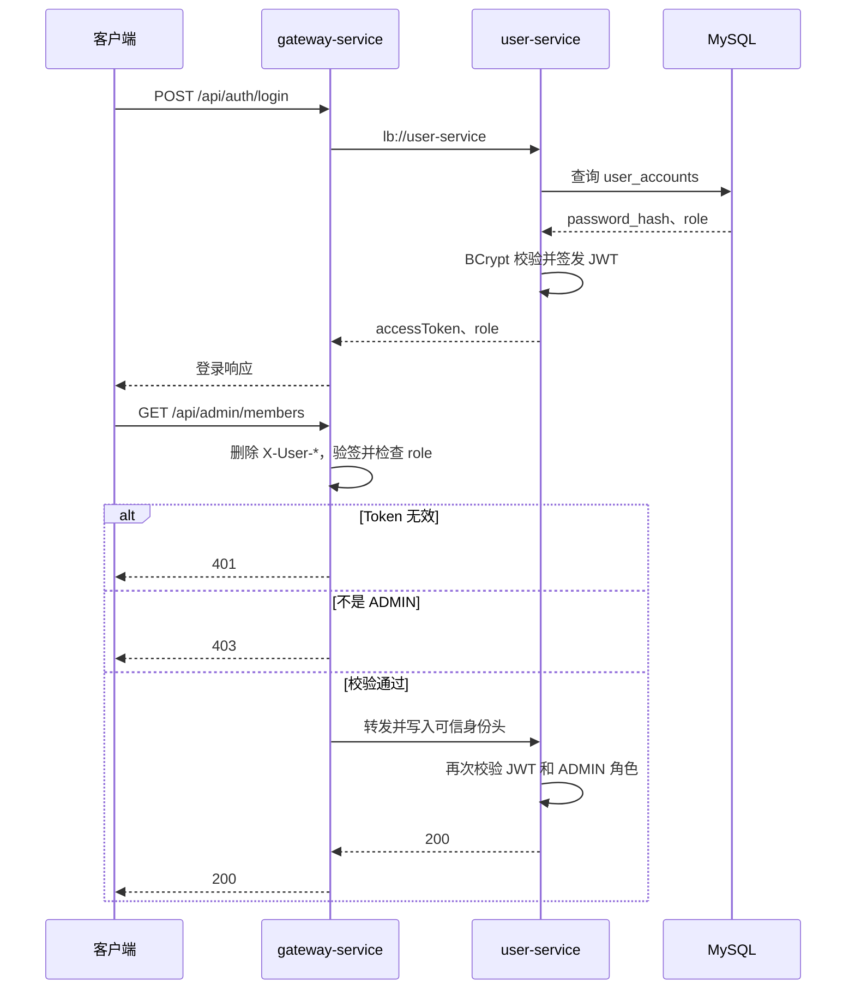

# 认证、授权与 API 网关设计

## 角色与测试账号

| 用户名 | 密码 | 角色 | 权限 |
| :--- | :--- | :--- | :--- |
| admin | root | ADMIN | 全部受保护接口，包括 /api/admin/** |
| member | root | MEMBER | 普通业务接口 |

账号由 user-service 的 DataInitializer 首次启动时创建，密码以 BCrypt 哈希保存。数据库中 password_hash 以 $2a$10$ 开头，长度为 60。

## 认证流程



## JWT 设计

| 项目 | 值 |
| :--- | :--- |
| 算法 | HS256 |
| 签发者 iss | user-service |
| 用户名 sub | 登录用户名 |
| 用户 ID uid | user_accounts.id |
| 角色 role | ADMIN 或 MEMBER |
| 签发时间 iat | 登录时刻 |
| 生效时间 nbf | 登录时刻 |
| 过期时间 exp | 默认 120 分钟 |
| 唯一标识 jti | 随机 UUID |
| 密钥 | 环境变量 JWT_SECRET，至少 32 字节 |

user-service 与 gateway-service 必须使用相同的 JWT_SECRET。密钥不写入仓库，只提交 .env.example 模板。

## 网关路由表

| 路由 ID | 路径 | 目标服务 | 认证要求 |
| :--- | :--- | :--- | :--- |
| user-auth | /api/auth/** | lb://user-service | 登录公开，/api/auth/me 需要 JWT |
| user-members | /api/members/** | lb://user-service | 需要 JWT |
| user-admin | /api/admin/** | lb://user-service | 需要 ADMIN |
| course-service | /api/courses/** | lb://course-service | 需要 JWT |
| booking-service | /api/book/** | lb://booking-service | 需要 JWT |

网关健康入口：

- GET /api/health
- GET /actuator/health

## 鉴权规则

| 请求 | 结果 |
| :--- | :--- |
| 不带 Token 访问 /api/admin/members | 401 |
| 伪造 X-User-Role: ADMIN | 401 |
| ADMIN Token 访问 /api/admin/members | 200 |
| MEMBER Token 访问 /api/admin/members | 403 |
| 不带 Token 访问 /api/members/1/check | 401 |
| 篡改 Token | 401 |
| 错误密码登录 | 401 |

## 伪造请求头与绕过网关

网关在转发前无条件删除 X-User-Id、X-User-Name、X-User-Role、X-User-Permissions、X-Gateway-Token。只有 JWT 验签通过后，才根据 Token 中的 uid、sub、role 写入可信的 X-User-Id、X-User-Name、X-User-Role。校验失败时直接返回 401 或 403，不进入路由转发。

user-service 的 /api/admin/** 不依赖 X-User-Role，而是再次校验 JWT 的签名和角色。即使绕过网关直接访问 8081，没有 Token 返回 401，MEMBER Token 返回 403。

Docker Compose 中所有服务位于 gym-network 内部网络。生产部署只发布 gateway-service 的 8080 端口，下游服务不映射宿主机端口。本仓库为了保留冒烟和 E2E 脚本，开发环境仍映射 8081、8082、8083。

## 运行与验证

```bash
docker compose up -d --build
docker compose ps
bash scripts/auth-test.sh
```

auth-test.sh 覆盖网关健康检查、未登录 401、伪造身份头 401、错误密码 401、管理员登录、管理员访问 200、会员登录、会员越权 403、受保护业务接口 200、无 Token 401、篡改 Token 401。失败时退出码为 1。

## 安全注意事项

- 不提交真实 .env、真实密钥和完整 Token。
- 生产环境使用 HTTPS，避免 Token 被窃听。
- Token 有效期按需调整，当前默认 120 分钟。
- 密码使用 BCrypt，不在日志中输出密码。
- 登录失败统一提示用户名或密码错误，不泄露账号是否存在。
- 角色目前为 ADMIN 和 MEMBER，后续可扩展为 RBAC 权限表。
