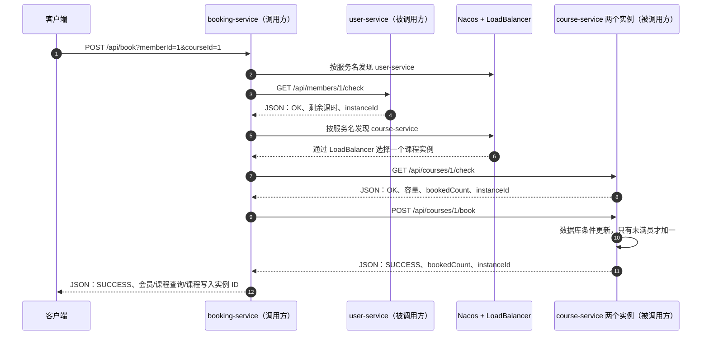

# 服务通信设计：会员预约课程

## 1. 业务场景与边界

本项目选择“会员预约健身课程”作为必须跨服务完成的业务流程。

booking-service 不保存会员课时和课程容量，因此不能只依靠自身完成预约。它必须先调用 user-service 检查会员状态和剩余课时，再调用 course-service 检查课程状态和剩余名额，最后请求 course-service 完成预约写入。

| 角色 | 服务 | 职责 |
| --- | --- | --- |
| 调用方 | booking-service | 接收预约请求，编排会员校验、课程校验和预约写入，统一处理调用失败 |
| 被调用方 | user-service | 拥有会员数据，检查会员是否存在以及是否有剩余课时 |
| 被调用方 | course-service | 拥有课程数据，检查课程是否存在、是否满员，并原子增加已预约人数 |

booking-service 只传递 memberId 和 courseId，不跨数据库 JOIN，也不直接修改其他服务的数据库。

## 2. 调用方、被调用方和接口路径

| 顺序 | 调用方向 | 方法与路径 | 作用 |
| --- | --- | --- | --- |
| 1 | 客户端 → booking-service | `POST /api/book?memberId={memberId}&courseId={courseId}` | 发起预约 |
| 2 | booking-service → user-service | `GET /api/members/{memberId}/check` | 查询会员状态、剩余课时和会员实例 ID |
| 3 | booking-service → course-service | `GET /api/courses/{courseId}/check` | 查询课程状态、容量、已预约人数和课程实例 ID |
| 4 | booking-service → course-service | `POST /api/courses/{courseId}/book` | 课程仍有名额时，将 bookedCount 原子加一 |

有响应体的业务接口均返回可检查的 JSON。

预约成功响应中的 `courseCheckInstanceId` 和 `courseInstanceId` 分别记录实际处理课程查询与课程写入的实例。端到端脚本同时收集这两个字段验证负载均衡，而不是仅展示 Nacos 注册列表。

## 3. 跨服务调用链路图



## 4. OpenFeign 实现方式

booking-service 在启动类上添加 `@EnableFeignClients`，并创建两个 OpenFeign 客户端：

- `@FeignClient(name = "user-service", path = "/api/members")`
- `@FeignClient(name = "course-service", path = "/api/courses")`

FeignClient 使用服务名进行调用，代码中没有写死容器 IP。

Nacos 负责提供服务实例列表，Spring Cloud LoadBalancer 负责从可用实例中选择实际调用的实例。

## 5. 负载均衡验证方式

course-service 启动两个实例。

compose.yaml 不设置 course-service 的 `container_name`，并使用 `127.0.0.1::8082` 让 Docker 随机分配不同的宿主机端口，从而避免多实例端口冲突。

两个实例仍在容器网络内监听 8082，并注册到相同的 Nacos 服务名和 `PERSONAL_GROUP` 分组。

启动命令：

```bash
docker compose up -d --build --scale course-service=2
```

课程服务的 instanceId 由 `HOSTNAME:server.port` 构成。Docker 会为不同容器设置不同的 hostname，因此可以通过 instanceId 判断请求实际由哪个实例处理。

端到端测试脚本连续发起 8 次预约，同时收集课程查询实例和课程写入实例。只有实际观察到至少两个不同的实例 ID，才判定负载均衡验证通过。

## 6. 失败处理与业务边界

| 情况 | booking-service 返回 | 是否执行课程写入 |
| --- | --- | --- |
| 会员不存在 | HTTP 404，JSON 错误信息 | 否 |
| 会员剩余课时为 0 | HTTP 400，JSON 错误信息 | 否 |
| user-service 不可用 | HTTP 503，明确说明预约未执行 | 否 |
| 课程不存在 | HTTP 404，JSON 错误信息 | 否 |
| 课程满员 | HTTP 409，JSON 错误信息 | 否 |
| course-service 查询失败 | HTTP 503，明确说明预约未执行 | 否 |
| course-service 写请求超时 | HTTP 504，包含 `WRITE_RESULT_UNKNOWN` | 结果未知 |

### 写操作超时的特殊说明

写操作超时不能直接判定为失败，也不能直接判定为成功。

因为请求可能已经到达 course-service 并完成数据库更新，只是响应没有及时返回。如果此时直接重试，可能造成重复预约。

因此本项目：

1. 禁止 Feign 自动重试。
2. 写超时返回 HTTP 504。
3. 错误信息包含 `WRITE_RESULT_UNKNOWN`。
4. 提示调用方先查询课程状态，再决定是否重试。

## 7. 测试设计

`BookingServiceTest` 使用 Mockito 模拟 FeignClient，覆盖以下情况：

1. 会员和课程校验通过，预约成功。
2. 会员剩余课时不足，返回 400，不调用课程服务。
3. 课程满员，返回 409，不执行课程写入。
4. user-service 不可用，返回 503，不调用课程服务。
5. 课程写请求超时，返回 504，结果标记为未知。

`scripts/e2e-test.sh` 负责真实端到端验证：

1. 自动创建新的会员和课程。
2. 完成真实跨服务预约。
3. 验证请求实际访问两个课程实例。
4. 停止 user-service，模拟依赖不可用。
5. 验证请求返回 503，而不是业务成功。
6. 验证失败前后的 bookedCount 不发生变化。
7. 恢复 user-service，再次验证预约成功。
